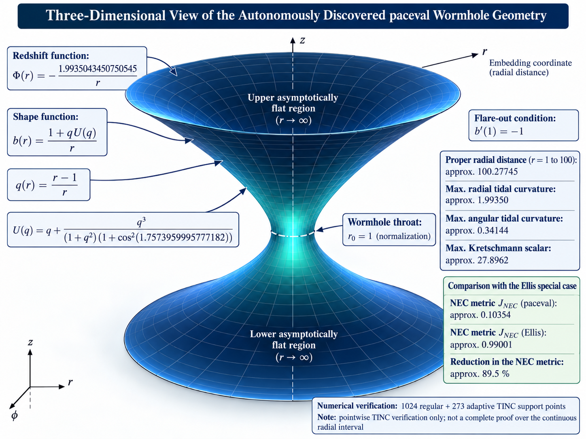
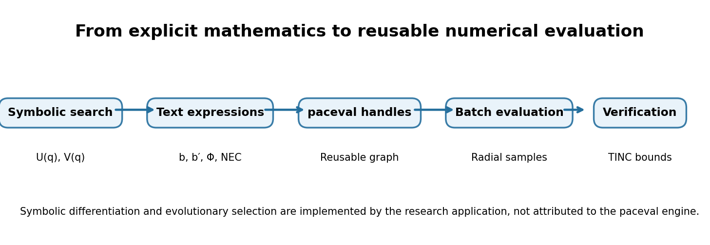
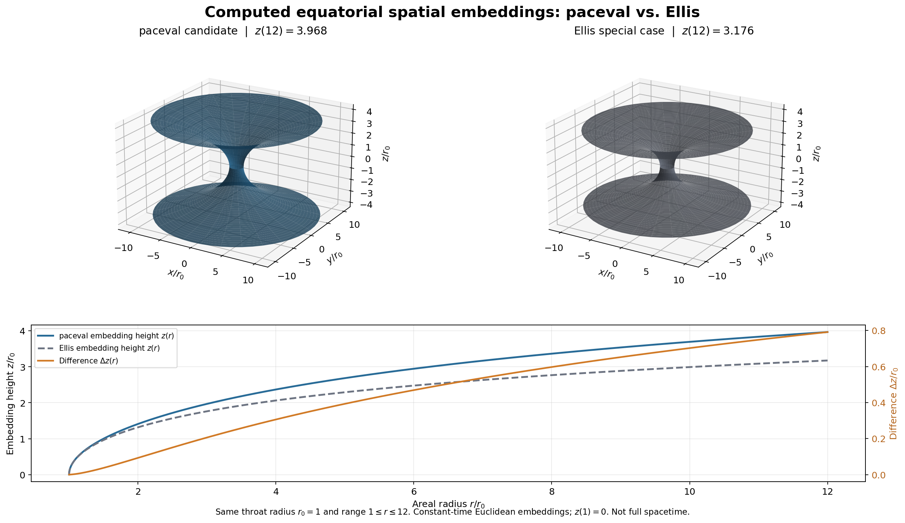
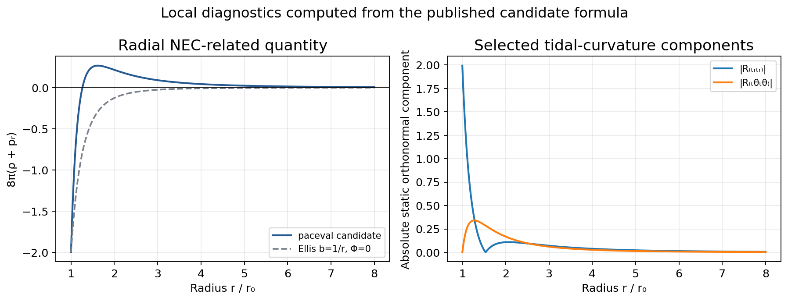
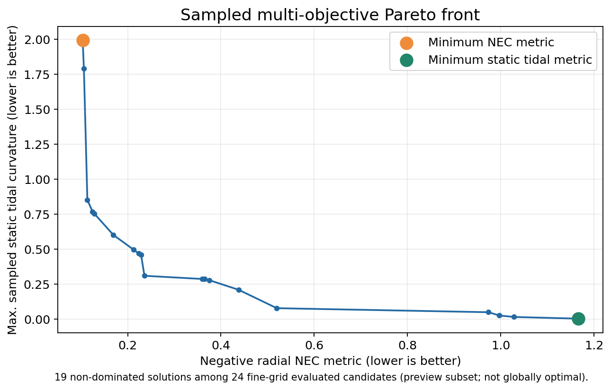
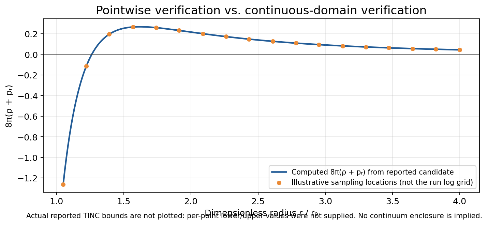

# Autonomous Discovery and Multi-Objective Analysis of Traversable Wormhole Geometries with paceval

**A reproducible computational research case study in general relativity, symbolic model search, numerical evaluation, and pointwise error assessment.**

> **Research status:** Exploratory computational results, not an observational detection of a wormhole, a proof of physical realizability, or a claim of a globally optimal geometry. The work uses the *paceval* mathematical engine for reusable, batched formula evaluation and Trusted Interval Computation (TINC) at sampled radial coordinates.



*Figure 1. Editorial 3D schematic of a two-sided wormhole with annotations from the reported run. **This image is an illustration, not a geometrically exact rendering of the metric.** Use Figure 3 for numerically integrated embedding surfaces. Physical units and traveler-specific tidal accelerations have not been established.*

## In brief

Can a program independently generate mathematical descriptions of candidate traversable wormholes, evaluate the consequences of those descriptions, and explore trade-offs between energy-condition violation and spacetime curvature? This research prototype investigates that question within the static, spherically symmetric Morris–Thorne metric framework.

Using symbolic expression trees and evolutionary selection, the application generated candidate shape and redshift functions. The resulting equations were evaluated through [paceval](https://paceval.com/), a mathematical runtime that converts text expressions into reusable computation structures, allowing repeated evaluation for different numerical inputs. A selected candidate was subsequently checked at discrete radial points with paceval's Trusted Interval Computation (TINC) mode.

For one documented run (random seed `20261029`, **100 evaluated candidates**, normalized throat radius `r₀ = 1`), the selected geometry yielded a **negative radial NEC metric of approximately 0.10354**, compared with **0.99001** for the massless Ellis reference under the *same program-defined metric and integration interval*. This is an **approximately 89.5% reduction in that particular numerical metric**, **not** a measured or proven 89.5% reduction in the amount of exotic matter required to construct a physical wormhole.

The selected geometry also has higher static tidal-curvature components than the Ellis reference, illustrating an important competing objective rather than a universal improvement.

## 1. What paceval contributes

[paceval](https://github.com/paceval/paceval) is a system-independent mathematical engine for evaluating explicit expressions. An input expression is processed into an internal computation structure that can be reused for many subsequent assignments of its input variables. This architecture is useful when one model must be evaluated across many points or parameter sets, as in numerical physics, engineering, and scientific computing.

In this research application:

1. **The research application** evolves symbolic expression trees, constructs the metric functions, performs symbolic differentiation, and defines the optimization criteria.
2. **paceval** evaluates the resulting expressions using reusable computation handles and batched numerical calls.
3. **TINC**, an optional evaluation mode of paceval, supplies numerical error-bound information for supported calculations at specified input values. The application checks the returned per-point status and bounds.
4. The application ranks accepted geometries and performs a subsequent multi-objective analysis.

**Scope of TINC:** Successful error-bound checks at a finite set of numerical inputs are **not** a verified enclosure of the functions over the entire continuous radial domain. Nor do they certify the numerical quadrature, the search procedure, the Einstein field equations themselves, or a physical matter model. A reported engine error in one run was resolved for the affected calculations through an algebraically equivalent alternative expression; the original operator-level cause of that engine status has not been established.



*Figure 2. Division of responsibilities between evolutionary symbolic search, computation-graph reuse, batched numerical evaluation, and pointwise TINC checking. The symbolic search is application logic; it is not presented as an inherent feature of the paceval runtime.*

## 2. Mathematical formulation

We use geometrized units (`G = c = 1`), dimensionless coordinates with `r₀ = 1`, and the standard static spherically symmetric Morris–Thorne line element:

$$
ds^2=-e^{2\Phi(r)}dt^2+\frac{dr^2}{1-b(r)/r}+r^2(d\theta^2+\sin^2\theta\,d\varphi^2).
$$

Here `b(r)` denotes the **shape function** and `Φ(r)` the **redshift function**. A traversable-wormhole candidate is tested for the throat condition `b(r₀) = r₀`, the flare-out condition `b′(r₀) < 1`, a well-defined redshift function, and suitable exterior behavior within the investigated domain. The stated tests are not substitutes for global proofs.

For this particular candidate, introduce

$$
q(r)=\frac{r-1}{r},\qquad a=1.7573959995777182,\qquad \gamma=1.9935043450750545.
$$

The application-generated expression is algebraically equivalent to the compact representation

$$
\boxed{U(q)=q+\frac{q^3}{(1+q^2)(1+\cos^2 a)}}
$$

and

$$
\boxed{b(r)=\frac{1+q(r)U(q(r))}{r}},\qquad
\boxed{\Phi(r)=-\frac{\gamma}{r}}.
$$

**Text expressions for reproducibility** (the variables and substitutions below are shown explicitly; this is readable expression notation, not a standalone source-code file):

```text
q = (r - 1) / r
U = q + (q*q*q) / ((1 + q*q) * (1 + cos(a)*cos(a)))
a = 1.7573959995777182
gamma = 1.9935043450750545
b = (1 + q*U) / r
Phi = -gamma / r
```

Equivalently, without symbolic parameters:

```text
b = (1 + ((r-1)/r) * (((r-1)/r) + (((r-1)/r)*((r-1)/r)*((r-1)/r)) / ((1+((r-1)/r)*((r-1)/r))*(1+cos(1.7573959995777182)*cos(1.7573959995777182))))) / r
Phi = -1.9935043450750545 / r
```

This family gives `b(1)=1` and, for the selected candidate, `b′(1)=-1`. These observations should be read within the normalization `r₀=1`.

### Energy-condition diagnostic

For the above metric, the radial null energy condition is expressed through

$$
8\pi(\rho+p_r)=\frac{b'(r)}{r^2}-\frac{b(r)}{r^3}+\frac{2}{r}\bigl(1-\frac{b(r)}r\bigr)\Phi'(r).
$$

The optimization reports a **program-defined negative-NEC radial metric**:

$$
\boxed{J_{\mathrm{NEC}}=\int_{1}^{100}\frac{r^2}{2}\max\!\bigl(0,-8\pi(\rho+p_r)\bigr)\,dr.}
$$

The numerical result is produced through sampled quadrature, not a TINC-certified integral enclosure. This diagnostic must not be identified without qualification with a physically complete quantity of exotic matter, a universal volume-integral quantifier, or a meaningful physical mass in the absence of dimensional scaling and additional assumptions.

## 3. Quantitative results of the documented run

| Diagnostic | Selected paceval candidate | Interpretation |
|:--|--:|:--|
| Negative radial NEC metric, `J_NEC` | **0.1035396212** | Sampled quadrature-based objective |
| Ellis reference, `J_NEC` | **≈ 0.99001** | Same objective and finite integration interval |
| Relative reduction vs. Ellis | **≈ 89.5%** | Reduction of *this metric only* |
| Throat derivative, `b′(1)` | **−1** | Satisfies local flare-out requirement |
| Max. absolute Ricci scalar | **≈ 5.98701** | Sampled curvature diagnostic |
| Max. Kretschmann scalar | **≈ 27.89621** | Sampled curvature diagnostic |
| Max. static radial tidal component | **≈ 1.99350** | Dimensionless orthonormal curvature component |
| Max. static angular tidal component | **≈ 0.34144** | Dimensionless orthonormal curvature component |
| Proper radial distance, `1 ≤ r ≤ 100` | **≈ 100.27745** | Numerical value in throat-radius units |
| Expression nodes | **11** | Complexity of the selected generated expression |

The reference is the **massless Ellis geometry** `b(r)=1/r, Φ(r)=0` in the same coordinate normalization. It is not the entirety of the Ellis–Bronnikov family. A different redshift, stress-energy model, throat radius, integration interval, or objective may change the ranking.



*Figure 3. Computed equatorial, constant-time Euclidean embeddings using the **same axes** and areal-radius range, $1\le r\le12$. The lower panel plots both embedding heights and the directly calculated difference $\Delta z(r)=z_{\mathrm{paceval}}(r)-z_{\mathrm{Ellis}}(r)$ with $z(1)=0$. At $r=12$, $\Delta z\approx0.792\,r_0$. The figures show a spatial slice, not a four-dimensional spacetime, physical traversability, or an amount of exotic matter.*

For these spatial embeddings, the Euclidean embedding height is computed from the shape function,

$$
\frac{dz}{dr}=\sqrt{\frac{b(r)}{r-b(r)}},\qquad z(r_0)=0,\qquad r_0=1.
$$

The integrable throat singularity is handled numerically by substituting $r=1+s^2$, so that $dz/ds=2s\sqrt{b(r)/(r-b(r))}$. Both sides are drawn as $+z(r)$ and $-z(r)$. The heights depend on a shared additive convention, and differences are interpreted only at matched areal radius.



*Figure 4. Profiles calculated directly from the stated compact analytic functions, including the massless Ellis NEC expression `8π(ρ+pᵣ) = −2/r⁴`. The tidal-curvature panel presents selected absolute **static orthonormal Riemann components**, not the acceleration felt by a traveler. These plots were independently regenerated from the published equations for visualization and are **not** themselves paceval/TINC output.*

## 4. Multi-objective exploration

A single NEC objective obscures competing requirements. We therefore consider the two-dimensional objective vector

$$
\min\bigl(J_{\mathrm{NEC}},\ T_{\mathrm{static}}\bigr),\qquad
T_{\mathrm{static}}=\max_r\bigl(\lvert R_{\hat t\hat r\hat t\hat r}\rvert ,\lvert R_{\hat t\hat\theta\hat t\hat\theta}\rvert \bigr).
$$

A candidate is *Pareto dominated* if another evaluated candidate is no worse on both objectives and strictly better on at least one. An exploratory evolutionary run collected candidate geometries; a preview-stage fine-grid assessment selected **24 candidates**, of which **19 were non-dominated within that assessed subset**. The 19 pairs have been transcribed from the run log into [`pareto_points.csv`](pareto_points.csv).



*Figure 5. Non-dominated points among the 24 fine-grid assessed geometries. The front is conditional on the explored candidate set and the sampled numerical metrics. It is not the globally optimal Pareto front, and the plotted points have not all received the selected winner's pointwise TINC checks.*

The lowest sampled NEC value among these candidates is `≈ 0.10354`, with a maximum sampled static tidal component of `≈ 1.99350`; the lowest tidal value in this subset is `≈ 0.00235`, at a higher NEC metric of `≈ 1.16602`. Neither extreme is a universal recommendation: the physically appropriate choice requires specifications for throat scale, traveler motion, matter content, and stability.

## 5. Numerical verification and its limits

The underlying application uses a two-stage numerical strategy: a lower-cost search evaluation followed by finer evaluation and targeted pointwise TINC checks on the selected geometry. The documented run reported:

- **3 analytic reference cases**, comprising regression checks for **12 derived physical quantities**;
- **1,024 regular radial TINC points** with no unresolved evaluations;
- **273 adaptively selected TINC points**, including **256 added points**, with no reported unresolved failures;
- zero inconclusive NEC sign classifications among the 1,024 regular points;
- a reported maximum NEC TINC interval width of approximately **`5.48 × 10⁻¹³`**, for the sampled inputs.

At one sampled radius, the primary expression triggered an engine diagnostic. An independently constructed **algebraically equivalent expression** was evaluated with TINC and successfully recovered the four affected field results, leaving zero unresolved evaluations in the documented run. This fallback supports the pointwise evaluation but does not establish the underlying cause of the diagnostic or a new formal result about the implementation.



*Figure 6. A model-derived NEC curve with **illustrative** sampling markers showing why isolated validated input values do not constitute a rigorous enclosure over every point of an interval. The actual numerical TINC lower/upper values were not available to draw statistically or numerically meaningful error bars; none have been invented.*

**Important distinctions:**

- **Numerical consistency** at selected points is not **continuous-domain validation**.
- **TINC bounds** on individual evaluations are not **certified quadrature error bounds**.
- **A compatible geometry** within the tested domain is not a demonstrated **stable solution with realizable matter**.
- A **static tidal curvature** is not a complete traveler-specific tidal acceleration; a physically meaningful assessment requires a physical throat scale, a worldline, and appropriate frame transformations.
- This is a theoretical search in general relativity; **no astronomical wormhole has been observed or detected by the program**.

## 6. Related research and novelty considerations

The construction builds on the Morris–Thorne geometric framework rather than introducing a new class of field equations. The Ellis/Bronnikov family provides an established baseline for traversable-wormhole geometries. Visser, Kar, and Dadhich (2003) studied wormholes involving arbitrarily small quantities of exotic matter under a specific global quantification. Their result means that our lower finite-interval NEC diagnostic relative to Ellis **cannot be advertised as a record-low exotic-matter requirement or proof of an entirely new physical phenomenon**.

The **methodological research question** is instead whether automatically generated mathematical expressions, repeated deterministic numerical evaluation, numerical error-bound checks, and multi-objective selection can systematically identify useful candidate spacetime geometries at competitive computational cost. Establishing a genuine contribution requires controlled comparisons with parametric search methods, independent formula validation, and deeper physical analysis.

## 7. Reproducibility and repository contents

This directory contains the research code, an archived execution log, and the English-language research report:

```text
README.md
assets/
  01_wormhole_schematic.png       # Editorial illustration; not metric-exact
  02_pareto_front.png             # 19 Pareto points transcribed from run log
  03_embedding_comparison.png     # Corrected shared-scale embeddings + z(r) and Δz(r)
  04_computation_workflow.png     # Engine and application responsibilities
  05_tinc_scope.png              # Model-derived curve, illustrative sample markers
  06_physics_diagnostics.png     # NEC and static tidal components from model
pareto_points.csv                # Exact values transcribed from run log
generate_figures.py              # Portable figure-generation script (NumPy, SciPy, Matplotlib, Pillow)
wormhole_research.cpp            # Stage-8 C++ research prototype, original paceval SDK dependency
documented_run_2026-10-30.log   # Archived console output from the reported run
paceval_Wormhole_Research_Report_EN.pdf  # English research report
```

**Research report:** [Wormhole Research Report (English, PDF)](https://github.com/paceval/paceval/blob/main/new%20projects/Wormholes%20and%20paceval/paceval_Wormhole_Research_Report_EN.pdf)

To regenerate the data-driven figures in a separate Python visualization environment:

```bash
python -m pip install numpy scipy matplotlib pillow
python generate_figures.py
```

**Reproduction note:** The plot script reads the bundled `pareto_points.csv` and produces the data-derived figures without access to a previous chat, local absolute paths or the paceval SDK. The included C++ research prototype requires the separate paceval SDK and its documented API. The archived log describes a specific Windows execution; its timings and outcomes are not guaranteed on other machines. Python is used **only to regenerate visualization**, not to implement the autonomous search or TINC. The 3D hero image remains an editorial schematic, not a numerically exact rendering.

Relevant public resources: [paceval GitHub repository](https://github.com/paceval/paceval) · [paceval website](https://paceval.com/) · [Example source code](https://github.com/paceval/paceval/tree/main/examples_sources)

## 8. Next scientific validation steps

1. Independently derive and validate every Einstein-tensor, Ricci, and Riemann component in a separate implementation.
2. Replace sparse pointwise checks with rigorous interval-domain methods, including validated quadrature where feasible.
3. Re-run the complete archive without the 24-candidate Pareto preview limit and assess multiple independent random seeds.
4. Compare against optimized *parametric* wormhole families using equal evaluation budgets and well-defined objectives.
5. Investigate matter models, junction conditions where applicable, stability, asymptotic properties, physical throat scales, and traveler-specific tidal acceleration.
6. Publish code, raw logs, candidate formulas, and numerical settings to support independent replication.

## Selected references

- M. S. Morris and K. S. Thorne, “Wormholes in spacetime and their use for interstellar travel: A tool for teaching general relativity,” *American Journal of Physics* **56**, 395–412 (1988). https://doi.org/10.1119/1.15620
- H. G. Ellis, “Ether flow through a drainhole: A particle model in general relativity,” *Journal of Mathematical Physics* **14**, 104–118 (1973). https://doi.org/10.1063/1.1666161
- M. Visser, S. Kar, and N. Dadhich, “Traversable wormholes with arbitrarily small energy condition violations,” *Physical Review Letters* **90**, 201102 (2003). https://doi.org/10.1103/PhysRevLett.90.201102
- K. Deb et al., “A fast and elitist multiobjective genetic algorithm: NSGA-II,” *IEEE Transactions on Evolutionary Computation* **6**, 182–197 (2002). https://doi.org/10.1109/4235.996017

---

**Takeaway:** This study demonstrates an autonomous workflow for generating, comparing, and pointwise checking mathematical wormhole candidates. The observed improvement is specific to a clearly defined radial NEC objective and an Ellis baseline. It is an encouraging computational result, **not yet a demonstration of a physically realizable wormhole or a new global bound on exotic matter**.
